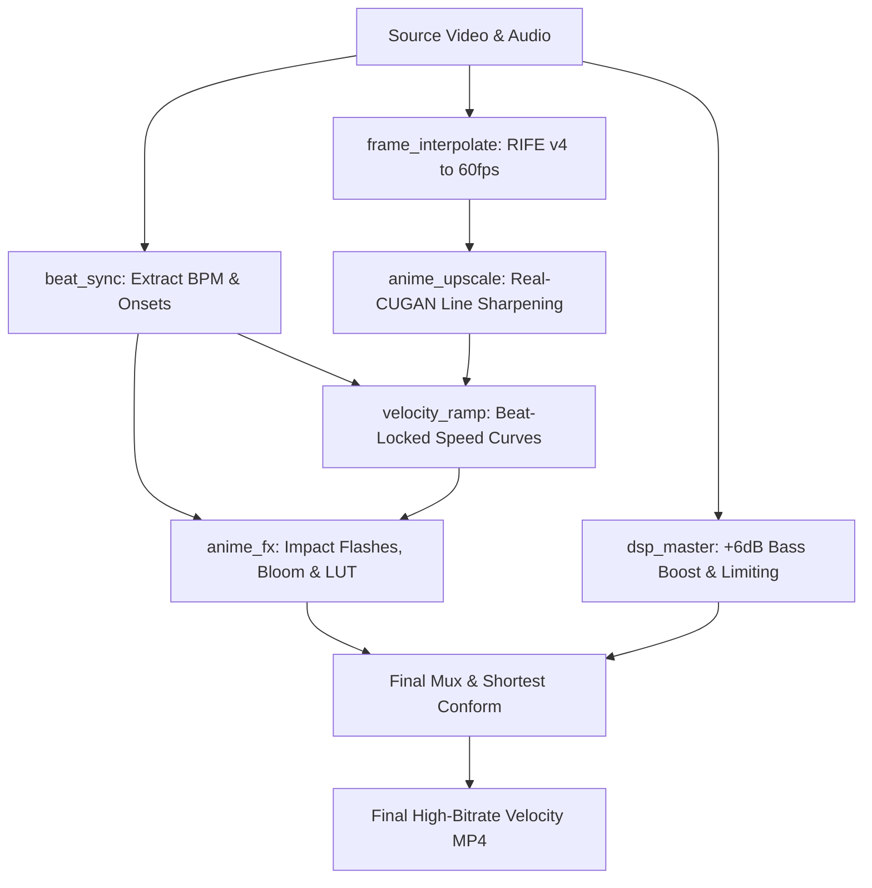

# Velocity & Anime Edit Production Skill

Automated pipeline orchestration and quality directives for high-energy anime velocity edits, phonk montages, and beat-locked kinetic video compositions.

---

## 1. Overview & Capability Matrix

The **Velocity Edit Pipeline** delivers automated, beat-synchronized video editing tailored for high-tempo anime action clips, phonk drift reels, and AMV highlight edits. It replaces manual keyframe time-remapping with algorithmic MIR analysis and GPU-accelerated Vulkan shaders.

### Core Tool Stack
- **`beat_sync`**: Sub-millisecond BPM tracking, onset detection, and downbeat segmentation via Librosa and deep-learning models.
- **`frame_interpolate`**: 60fps / 120fps motion smoothing using RIFE v4 on Intel Arc Vulkan (`-g 0`).
- **`anime_upscale`**: High-frequency line art preservation and artifact cleanup via Real-CUGAN / Real-ESRGAN.
- **`velocity_ramp`**: Exponential time-remapping curves with rubberband pitch-preserved audio stretching.
- **`anime_fx`**: Single-pass compositor for chromatic aberration, RGB split, anime bloom, zoom punch, screen shake, 35mm grain, vignette, letterbox, and 3D LUT grading.
- **`dsp_master`**: Low-shelf bass boost (+6dB @ 110Hz), dynamic compression, and -9 LUFS limiting via Spotify's Pedalboard.
- **`anime_edit`**: End-to-end master orchestrator uniting all 6 modular stages.

---

## 2. Quality Rules & Kinematic Directives

To maintain professional AMV / Phonk quality and avoid common AI video editing artifacts, adhere strictly to the following engineering standards:

### 2.1 Cut Timing & Beat Alignment
- **Sub-15ms Rule**: All scene cuts, speed ramp transitions, and impact flashes must snap within **15ms** of detected beat/downbeat timestamps.
- **Transients Over Grid**: When syncopated drums deviate from the static BPM grid, prioritize onset envelope peaks from `beat_sync` over mathematical quantize grids.

### 2.2 Kinematic Velocity Curves
- **Default Kinematics**: Use `expo` (exponential) easing curves for speed transitions:
  - **Anticipation (Slow-Mo)**: Decelerate to 0.25x speed (400% time stretch) in the 400ms preceding the beat impact.
  - **Impact Snap (Hyper-Speed)**: Snap to 2.0x speed for 200ms immediately following the beat drop.
- **Never Linear**: Linear speed transitions appear mechanical and lifeless; always use exponential or power-based velocity ramps.

### 2.3 Hardware Execution & Acceleration
- **Intel Arc Vulkan Only**: All neural upscaling and frame interpolation must execute on Vulkan API (`-g 0`). Never introduce CUDA or NVIDIA-specific runtime dependencies.
- **Graceful CPU Degradation**: If standalone Vulkan binaries are absent, tools must automatically fall back to CPU FFmpeg filters (`minterpolate`, `scale=lanczos`, `equalizer`) without failing the pipeline.

### 2.4 Visual Fidelity & Subject Clarity
- **Keep Subject Sharp**: Apply chromatic aberration, screen shake, and blur selectively during impact bursts. Do not wash out the focal subject with permanent heavy bloom or excessive RGB split.
- **Tetrahedral Grading**: Always apply 3D LUT `.cube` files using tetrahedral interpolation (`interp=tetrahedral`) to eliminate color banding across anime gradients.

---

## 3. Style Presets

| Style Preset | Target Aesthetic | Enabled FX Suite | Default LUT |
| :--- | :--- | :--- | :--- |
| **`velocity`** | High-energy anime battle clips | Chromatic aberration + Glow + Zoom punch + Screen shake + Film grain + Impact flash | `anime_vibrant.cube` |
| **`phonk`** | Drift car & gritty anime edits | Chromatic aberration + RGB split + Heavy glow + Screen shake + Film grain + Impact flash | `cyberpunk_neon.cube` |
| **`amv`** | Cinematic narrative trailers | Soft glow + 35mm grain + Radial vignette + 2.39:1 Letterbox | `cinematic_teal_orange.cube` |
| **`subtle`** | Clean organic polish | Light film grain + Subtle vignette | `vintage_warm_film.cube` |

---

## 4. Execution Flow

